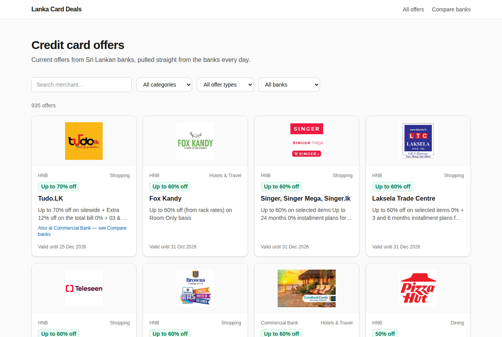
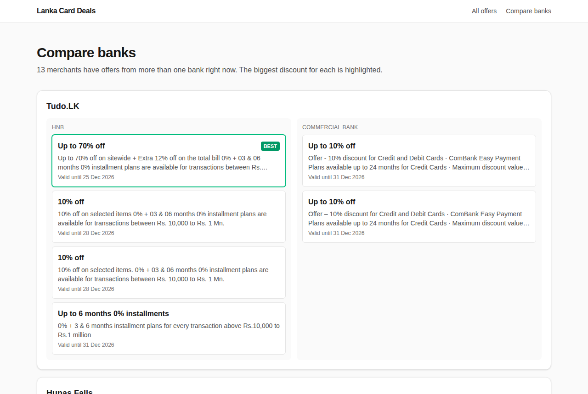
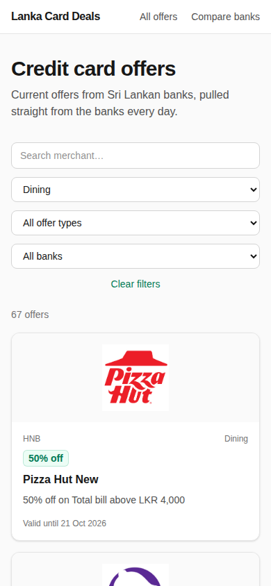

# Lanka Card Deals

**Every current credit card offer from Sri Lankan banks, in one place, updated daily.**

**Live:** https://card-off.vercel.app



Banks publish their card offers on separate sites, each with its own layout. This
app scrapes them every morning, cleans the data into one format, and lets you search,
filter, and compare offers for the same merchant across banks.

- **~935 live offers** from HNB and Commercial Bank
- **Compare banks:** merchants offered by more than one bank, side by side, with the best deal highlighted
- **Filters** by category, offer type (discount / cashback / installment), bank, and merchant search, all kept in the URL so links are shareable
- **Runs on free tiers only:** Vercel Hobby, MongoDB Atlas M0, GitHub Actions

| Compare banks | Mobile |
|---|---|
|  |  |

## Stack

Next.js 15 (App Router, Server Components) · TypeScript · MongoDB Atlas + Mongoose · Zod ·
Tailwind CSS · GitHub Actions · Vercel · Node's built-in test runner

## How it works

```
GitHub Actions — daily 06:00 Sri Lanka time
  └─ scraper/run.ts
       ├─ banks/hnb.ts       HNB: public JSON API (list + per-offer detail)
       ├─ banks/combank.ts   Commercial Bank: server-rendered HTML (listing + detail pages)
       ├─ parseDiscount      classify: percentage / cashback / installment / other
       ├─ category           keyword-based category detection
       └─ db.ts              bulk upsert by bank + sourceUrl, expire ended or removed offers
                                    ▼
                              MongoDB Atlas
                                    ▼
Next.js on Vercel
  ├─ /             offer grid, server-rendered, filters in the URL
  ├─ /compare      merchants with offers from 2+ banks
  └─ /api/offers   JSON API: ?bank= &category= &type= &q= &page=
```

Each scraper validates every offer with the same Zod schema before it reaches the database,
so a layout change at a bank shows up as skipped offers in the logs instead of bad data on the site.

## Problems solved along the way

**HNB's obvious API returns a random sample.** `venus.hnb.lk/api/get_all_pcard_promotions`
(the endpoint most scrapers use) returns a random 20 promotions per call. Reading HNB's
frontend bundle turned up `get_all_web_card_promos?limit=1000`, the full ~900-item
list, plus a per-offer detail endpoint and the real image host (`assets.hnb.lk/atdi/`).
The list also repeats each offer once per category, so the scraper removes duplicates by id.

**Commercial Bank rate-limits hard.** combank.lk sits behind an AWS WAF that answers
CloudFront 403 after ~75 requests in a few minutes. Detail pages are fetched 2 at a time
with a delay, and the scraper stops fetching details after the first 403. Offers are
still saved from the listing page, so a rate-limited run degrades to "no description"
rather than "no data".

**Fees that look like discounts.** Payment-plan terms list commission such as
"12 Months – 3.5% · 36 Months – 9%", which a naive parser shows as "9% off". Clauses about
commission or handling fees are excluded from discount parsing, and installment offers say
"0%" only when the bank does.

**One bad run shouldn't empty the site.** Offers missing from a scrape are marked expired,
except when a run finds fewer than half the currently active offers. That points to a
broken scrape, not to the bank removing its offers.

**Matching merchants across banks.** "SPAR Supermarkets" (HNB) and "Spar Supermarket"
(ComBank) are normalised to the same key. Normalisation is deliberately conservative: removing
"restaurants" from names would wrongly match "Softlogic Restaurants" with an unrelated
"Softlogic" retail offer.

## Local setup

```bash
npm install
cp .env.example .env.local   # fill in MONGODB_URI
npm run scrape               # fill the DB with real offers (~2–3 min)
npm run dev
```

No Atlas account? Run Mongo locally:

```bash
docker run -d --name lcd-mongo -p 127.0.0.1:27017:27017 mongo
# MONGODB_URI=mongodb://127.0.0.1:27017
```

## Scripts

| Command | What it does |
|---|---|
| `npm run scrape` | Scrape all banks and write to MongoDB |
| `npm run scrape -- --dry-run` | Scrape and print a summary, no DB needed |
| `npm test` | Unit tests: parsers, scrapers, merchant matching (fixtures from real bank pages) |
| `npm run type-check` | TypeScript check |

CI runs type-check, tests, and a production build on every push.

## Roadmap

- More banks (Sampath, NTB and BOC need a headless browser because of bot protection)
- Offer detail page, and "ending soon" sorting
- Email alerts for a chosen merchant or category

See [PLAN.md](./PLAN.md) for the original two-week plan, scope decisions, and progress log.
